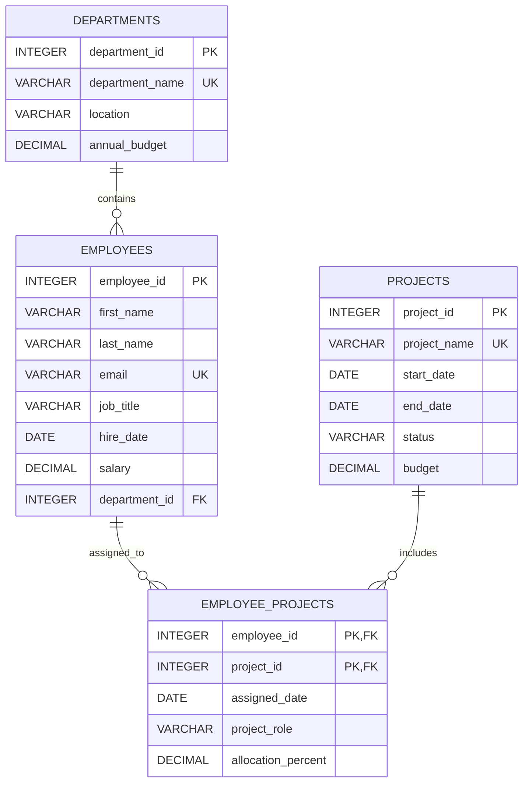

# Employee Management Database

## Overview

This relational design tracks departments, employees, projects, and employee assignments to projects. An employee belongs to one department. Employees and projects have a many-to-many relationship, represented by `EMPLOYEE_PROJECTS`.

The scripts use standard SQL data types and explicit IDs in the sample data. Run `01_create_tables.sql` first, followed by `02_insert_sample_data.sql`.

## ER diagram



## Table definitions and keys

| Table | Purpose | Primary key | Foreign keys and constraints |
|---|---|---|---|
| `DEPARTMENTS` | Department name, location, and annual budget | `department_id` | `department_name` is unique; `annual_budget` must be non-negative |
| `EMPLOYEES` | Employee identity, work details, salary, and department | `employee_id` | `department_id` references `DEPARTMENTS.department_id`; `email` is unique; `salary` must be non-negative |
| `PROJECTS` | Project schedule, status, and budget | `project_id` | `project_name` is unique; `end_date` cannot precede `start_date`; `status` is limited to Planned, Active, or Completed; `budget` must be non-negative |
| `EMPLOYEE_PROJECTS` | Assignment of employees to projects, including their role and allocation | (`employee_id`, `project_id`) | `employee_id` references `EMPLOYEES.employee_id`; `project_id` references `PROJECTS.project_id`; allocation must be between 0 and 100 percent |

## Sample data

The insert script contains 5 departments, 20 employees, 10 projects, and 30 employee-to-project assignments.

## Scripts

- [01_create_tables.sql](./01_create_tables.sql) — creates all four tables and their primary key, foreign key, unique, and check constraints.
- [02_insert_sample_data.sql](./02_insert_sample_data.sql) — inserts the sample records in foreign-key-safe order.
- [build_sqlite_db.py](./build_sqlite_db.py) — builds or validates the SQLite database using Python's standard library.
- [employee_management.db](./employee_management.db) — populated SQLite database created from the scripts above.

## Build and access the SQLite database

From this folder, build the database (or validate it if it already exists):

```powershell
py build_sqlite_db.py
```

To deliberately recreate the database from the SQL scripts:

```powershell
py build_sqlite_db.py --force
```

The `--force` option replaces the database file, so back up any data you want to keep. To choose another output file, pass `--database "C:\path\to\employee_management.db"`.

The `.db` file is a binary database, not a text file. Open it with a SQLite viewer, such as the SQLite extension in VS Code or DB Browser for SQLite. To access it from Python:

```python
import sqlite3

connection = sqlite3.connect("employee_management.db")
try:
    for row in connection.execute("SELECT employee_id, first_name, last_name FROM EMPLOYEES"):
        print(row)
finally:
    connection.close()
```
