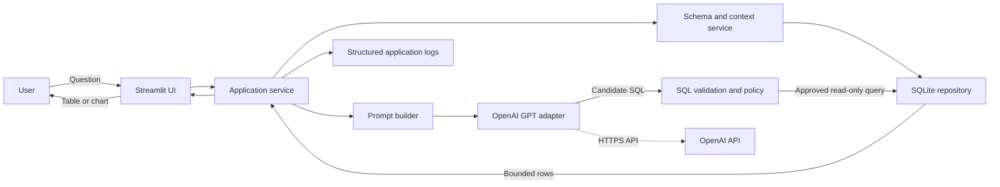
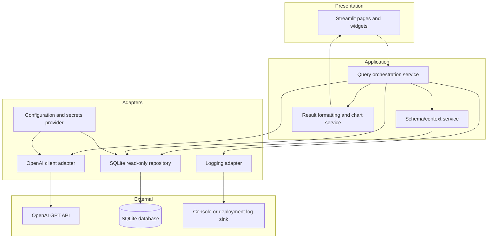
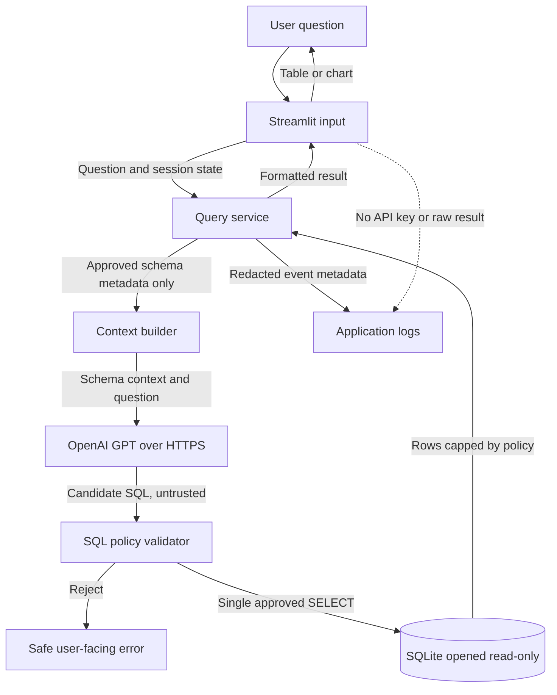

# InsightSQL Architecture

## 1. System architecture

InsightSQL is a Streamlit application that turns a user's natural-language
question into a read-only query against an approved SQLite database. OpenAI GPT
may help draft SQL, but generated SQL is untrusted input: the application
validates it before execution and never gives the model direct database access.



The SQLite database is the source of truth. GPT is an optional language
interface, not an authority for access control, schema truth, or query safety.

## 2. Component diagram



Keep UI code thin. Application services coordinate work; adapters isolate
SQLite, OpenAI, configuration, and logging so they can be replaced or mocked in
tests.

## 3. Data flow diagram



1. The user submits a question in the Streamlit UI.
2. The application loads only the approved schema metadata needed for the
   question. It should not send table contents or personal data to GPT by
   default.
3. The OpenAI adapter sends the question and schema context over HTTPS and
   receives a candidate query.
4. The SQL policy validates the candidate. Invalid or disallowed SQL is
   rejected; it is never retried by executing it.
5. The repository executes approved SQL against a read-only SQLite connection
   with execution and result limits.
6. Results are formatted for the UI. Logs record safe operational metadata,
   not secrets or sensitive contents.

## 4. Suggested folder structure

```text
sql_insight/
├── streamlit_app.py              # Streamlit entry point
├── pyproject.toml                # Project and pytest configuration
├── requirements.txt              # Runtime dependencies, if not using pyproject
├── .env.example                  # Variable names and safe placeholders only
├── .gitignore                    # Exclude secrets, local databases, caches
├── README.md
├── ARCHITECTURE.md
├── .streamlit/
│   └── config.toml               # Non-secret Streamlit settings
├── src/
│   └── insightsql/
│       ├── __init__.py
│       ├── config.py             # Validated environment/secrets loading
│       ├── services/
│       │   ├── query_service.py  # Use-case orchestration
│       │   ├── schema_service.py # Approved schema metadata
│       │   └── result_service.py # Table/chart formatting and limits
│       ├── llm/
│       │   ├── client.py         # OpenAI API adapter
│       │   └── prompts.py        # Versioned prompt templates
│       ├── database/
│       │   ├── connection.py     # Read-only connection and timeouts
│       │   ├── repository.py     # Query execution boundary
│       │   └── sql_policy.py     # SQL validation and restrictions
│       ├── logging_config.py
│       └── exceptions.py         # Typed application exceptions
└── tests/
    ├── conftest.py               # Temporary SQLite fixtures and fakes
    ├── unit/
    │   ├── test_sql_policy.py
    │   ├── test_query_service.py
    │   └── test_result_service.py
    ├── integration/
    │   ├── test_sqlite_repository.py
    │   └── test_openai_adapter.py
    └── ui/
        └── test_streamlit_app.py
```

The structure is a recommended starting point; create modules as their
responsibilities are implemented. Keep local `.db` files and secrets out of
version control unless a specific sanitized sample database is intentionally
part of the project.

## 5. Security strategy

- **Secrets:** Load the OpenAI API key from deployment secrets or environment
  variables. For local Streamlit use, `.streamlit/secrets.toml` is acceptable
  only when excluded from version control. Never put keys in source, prompts,
  logs, screenshots, or client-visible UI.
- **Database access:** Open SQLite with a read-only URI, such as
  `file:/absolute/path/app.db?mode=ro`, enable `PRAGMA query_only = ON`, and
  disable extension loading. Use a least-privilege database containing only
  data the application is authorized to expose.
- **Generated SQL:** Treat model output as untrusted. Enforce one statement,
  allow only a supported read-only `SELECT` (including explicitly supported
  read-only CTEs), reject DDL/DML, `PRAGMA`, `ATTACH`, and other unapproved
  constructs. Use a SQLite-aware parser or an equivalent robust validator;
  do not rely on substring checks or a prompt instruction alone.
- **Execution limits:** Apply a query timeout/progress handler, cap returned
  rows, and bound prompt and result sizes. Consider allowlisting tables and
  columns. Avoid exposing schema objects or data outside the user's purpose.
- **Injection and model output:** Bind values as SQL parameters wherever
  applicable. Never concatenate untrusted user input into executable SQL.
  Validate table/column identifiers against the approved schema.
- **Privacy:** Send only the minimum question and schema context needed to the
  model. Do not send employee records or other sensitive values by default.
  Disclose external processing to users and follow applicable data-retention
  and provider policies.
- **UI and deployment:** Do not treat hidden widgets or session state as
  authorization. Avoid rendering model output as trusted HTML. Use HTTPS,
  restrict deployment access, and keep dependencies updated.
- **Abuse controls:** Add request limits and bounded retries for external API
  use; avoid logging raw prompts, SQL, query results, or credentials.

## 6. Logging strategy

- Use Python's standard `logging` module, configured once at application
  startup. Use structured key/value or JSON logs in deployed environments.
- Include timestamp, severity, event name, request/correlation ID, component,
  duration, and outcome. Keep user identity out unless needed and approved.
- Log lifecycle events such as request started/completed, model call outcome,
  SQL policy decision, query duration, row count, and exception category.
- Redact API keys, connection strings, user-provided text, generated SQL, and
  result values. Prefer stable error codes and safe metadata over raw payloads.
- Send logs to standard output for container platforms or the configured
  protected log sink. Restrict access and retention according to policy.
- Never show stack traces or provider error payloads to end users; preserve
  diagnostic details only in appropriately protected server logs.

## 7. Exception-handling strategy

Define typed exceptions at application boundaries, for example
`ConfigurationError`, `ModelProviderError`, `SQLPolicyError`,
`DatabaseAccessError`, and `QueryTimeoutError`.

- Validate configuration at startup and fail clearly if required settings are
  missing; do not silently fall back to an unsafe database or key.
- Translate provider/network errors in the OpenAI adapter, use bounded
  timeouts and limited retries only for transient failures, and never retry
  unsafe SQL execution.
- Reject invalid SQL before it reaches SQLite. Return a concise, actionable
  message such as “I couldn't produce an approved read-only query.”
- Translate SQLite errors at the repository boundary. Distinguish invalid
  query, timeout, and unavailable database cases without leaking SQL or data.
- Catch expected application exceptions at the Streamlit boundary, log a
  redacted event with a correlation ID, and show a safe message. Do not use
  broad catches that hide programming errors or imply success.
- Ensure database connections are closed using context managers, and leave the
  UI in a consistent state after failures.

## 8. Testing strategy

- **Unit tests (pytest):** Test SQL policy allow/deny cases, prompt/context
  construction, configuration validation, result limits, formatting, and
  exception translation. Mock the OpenAI adapter; do not make real API calls.
- **SQLite integration tests:** Create a temporary database per test, apply the
  schema, and verify repository queries, read-only behavior, foreign-key
  handling, timeouts, row caps, and cleanup.
- **Security regression tests:** Reject `INSERT`, `UPDATE`, `DELETE`, `DROP`,
  `CREATE`, `PRAGMA`, `ATTACH`, multiple statements, disallowed tables, and
  malformed model output. Verify the configured SQLite authorizer or
  read-only connection blocks writes even if validation has a defect.
- **Adapter tests:** Mock HTTP/provider responses for success, timeout, rate
  limit, malformed response, and authentication failure. Keep optional live
  provider checks separate and disabled by default.
- **UI tests:** Check the question-to-result flow, empty input, loading state,
  safe error display, and that raw stack traces and secrets are never shown.
- **Quality gates:** Run `pytest`, linting, and type checks in CI. Use fixtures
  with synthetic data; do not include production employee data or API
  credentials in tests.
